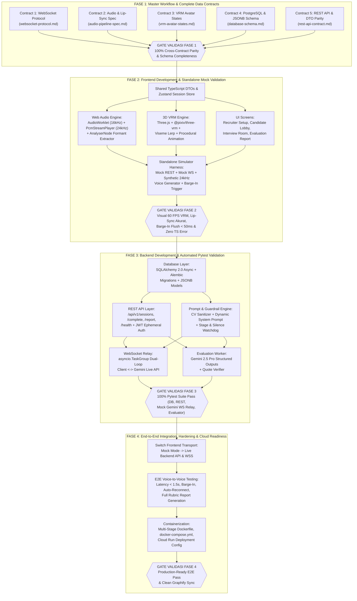

# Master Architecture & Contract-First Engineering Workflow (`ARCHITECTURE_AND_WORKFLOW.md`)

- **Document Version:** `1.0.0`
- **Last Updated:** 2026-10-26
- **Status:** `Active — Engineering Blueprint`
- **Related Documents:** [PRD.md](../PRD.md), [STATE.md](./STATE.md), [ADR-001](./decisions/ADR-001-core-architecture.md), [ADR-002](./decisions/ADR-002-backend-tech-stack-and-session-protocol.md), [System Contracts](./contracts/README.md)

---

## 1. Filosofi Rekayasa: Contract-First & Standalone-Validated Phases

Proyek **Real-Time AI Interviewer Platform** menggabungkan beberapa subsistem real-time yang sensitif terhadap latensi dan sinkronisasi state:
1. **3D VRM Avatar Engine & Viseme Lip-Sync** di browser (`Three.js` + `@pixiv/three-vrm` + `AnalyserNode`).
2. **Full-Duplex Web Audio Pipeline** (`AudioWorkletNode` 16kHz PCM capture + `PcmStreamPlayer` 24kHz gapless playback).
3. **Hybrid WebSocket Relay** di backend (`FastAPI` + `uvloop` + `asyncio.TaskGroup`).
4. **Native Voice-to-Voice Intelligence & Structured Evaluation** (`Gemini Multimodal Live API` + `Gemini 2.5 Pro` + `PostgreSQL 16 JSONB`).

Jika kita langsung menulis kode Frontend dan Backend secara bersamaan tanpa kontrak yang terkunci dan tanpa alat uji mandiri (*standalone test harness*), proses debugging akan sangat rumit (sulit membedakan apakah bug berasal dari `AudioWorklet`, shader VRM, WebSocket framing, atau koneksi Gemini Live).

Oleh karena itu, seluruh siklus pembangunan dibagi menjadi **4 Fase Berurutan dengan Validation Gate Mutlak**:
> **Aturan Emas (Golden Rule):** *Dilarang melangkah ke Fase $N+1$ sebelum seluruh checklist Validation Gate pada Fase $N$ terpenuhi 100% dan tercatat di [docs/STATE.md](./STATE.md).*

---

## 2. Diagram Urutan Dependensi 4 Fase Rekayasa



---

## 3. Rincian Eksekusi & Gate Validasi per Fase

### FASE 1: Master Implementation Workflow & Complete Data Contracts (`docs/contracts/`)

#### Tujuan
Mengunci seluruh spesifikasi komunikasi, struktur tabel database, payload REST API, protokol biner/JSON WebSocket, pipeline audio, dan state machine 3D VRM sehingga tidak ada ambiguitas sedikit pun saat menulis kode di Fase 2 dan Fase 3.

#### Deliverables Utama
1. **[docs/ARCHITECTURE_AND_WORKFLOW.md](./ARCHITECTURE_AND_WORKFLOW.md)** (dokumen ini).
2. **[docs/contracts/websocket-protocol.md](./contracts/websocket-protocol.md)** — Spesifikasi Hybrid WebSocket (`0x02` Binary PCM 16kHz/24kHz + `0x01` JSON Control Frames).
3. **[docs/contracts/audio-pipeline-spec.md](./contracts/audio-pipeline-spec.md)** — Spesifikasi `AudioWorklet` downsampling 16kHz, `PcmStreamPlayer` 24kHz gapless playback, dan ekstraksi formant `AnalyserNode`.
4. **[docs/contracts/vrm-avatar-states.md](./contracts/vrm-avatar-states.md)** — Spesifikasi state machine VRM (`IDLE`, `LISTENING`, `THINKING`, `SPEAKING`, `INTERRUPTED`), viseme lerp, dan animasi tulang prosedural.
5. **[docs/contracts/database-schema.md](./contracts/database-schema.md)** — Spesifikasi 5 tabel PostgreSQL 16 (`job_positions`, `candidates`, `interview_sessions`, `interview_transcripts`, `evaluation_reports`), tipe `ENUM`, indeks, dan JSON Schema untuk seluruh kolom `JSONB`.
6. **[docs/contracts/rest-api-contract.md](./contracts/rest-api-contract.md)** — Spesifikasi 6 endpoint `/api/v1/...`, format error standar, matriks HTTP status code, dan pemetaan 1:1 antara TypeScript Interfaces dan Pydantic v2 Models.

#### Checklist Gate Validasi Fase 1 (Definition of Done)
- [x] **Gate 1.1 (Kelengkapan 5 Kontrak):** Seluruh 5 dokumen kontrak tersedia di `docs/contracts/` dengan status `Locked (v1.0.0)` dan terdaftar di `docs/contracts/README.md`.
- [x] **Gate 1.2 (Konsistensi Penamaan Field 100%):** Nama field kunci (`session_id`, `turn_id`, `turn_seq`, `stage` / `current_stage`, `state`, `emotion`, `speaker`) telah diaudit silang dan bebas dari perbedaan nama atau typo di seluruh dokumen kontrak dan `PRD.md`.
- [x] **Gate 1.3 (Validitas Skema Database & JSONB):** ERD Mermaid valid, kelima tabel memiliki definisi Primary Key, Foreign Key, Indeks, dan JSON Schema eksak untuk `rubric_config`, `cv_structured_summary`, serta `competency_scores`.
- [x] **Gate 1.4 (TypeScript <-> Pydantic Parity):** Setiap DTO request dan response di `rest-api-contract.md` memiliki pasangan definisi TypeScript Interface dan Pydantic v2 Model yang identik.
- [x] **Gate 1.5 (Knowledge Graph Sync):** Seluruh node dokumen kontrak dan workflow telah diekstraksi dan terhubung di `graphify-out/graph.json` serta `graphify-out/GRAPH_REPORT.md`.

---

### FASE 2: Frontend Development & Standalone Validation (`frontend/`)

#### Tujuan
Membangun aplikasi web sisi klien secara utuh (UI + 3D VRM Avatar + Lip-Sync + Web Audio Pipeline) dan membuktikan seluruh fungsinya berjalan mulus pada 60 FPS **secara mandiri (standalone)** menggunakan **Mock/Simulator Harness** sebelum Backend ditulis.

#### Struktur Modul Target (`frontend/`)
```text
frontend/
├── public/
│   ├── models/                      # Default VRM avatar model (misal: alya.vrm / procedural fallback)
│   └── worklets/
│       └── pcm-capture-processor.js # AudioWorklet processor (downsample -> 16kHz Int16 PCM 40ms)
├── src/
│   ├── types/
│   │   ├── api.types.ts             # 1:1 dari docs/contracts/rest-api-contract.md
│   │   └── ws.types.ts              # 1:1 dari docs/contracts/websocket-protocol.md
│   ├── engine/
│   │   ├── vrm/
│   │   │   ├── VrmAvatarEngine.ts   # Three.js scene, camera, lighting, @pixiv/three-vrm loader
│   │   │   ├── VrmLipSync.ts        # AnalyserNode FFT/RMS -> aa, ih, ou, ee, oh asymmetric lerp
│   │   │   ├── VrmProceduralAnim.ts # Auto-blink, chest breathing, head sway, active listening nod
│   │   │   └── QualityGovernor.ts   # Adaptive FPS governor (Tier 1 / Tier 2 / Tier 3)
│   │   └── audio/
│   │       ├── MicCaptureManager.ts # getUserMedia + AudioWorkletNode + Local VAD ducking
│   │       └── PcmStreamPlayer.ts   # 24kHz Int16->Float32 gapless queue + <50ms barge-in flush
│   ├── services/
│   │   ├── apiClient.ts             # REST API client (mendukung Live HTTP & Mock Interceptor)
│   │   ├── wsClient.ts              # Hybrid WebSocket client (Binary PCM + JSON + Auto-Reconnect)
│   │   └── simulator/
│   │       ├── MockInterviewHarness.ts # Simulator server WS & generator suara sintetis 24kHz
│   │       └── mockFixtures.ts      # Fixture data sesi, transkrip, dan EvaluationReport
│   ├── store/
│   │   └── useInterviewStore.ts     # Zustand store (session state, stage, captions, devices)
│   └── pages/
│       ├── RecruiterSetupPage.tsx   # Buat sesi baru (JD, CV, Rubrik, VRM/Voice picker)
│       ├── RecruiterDashboardPage.tsx # Daftar sesi & status
│       ├── CandidateLobbyPage.tsx   # Device check, mic meter, speaker test, VRM preload, consent
│       ├── InterviewRoomPage.tsx    # 3D VRM canvas, stage stepper, timer, captions, controls
│       ├── InterviewCompletedPage.tsx # Layar selesai kandidat & CSAT
│       └── EvaluationReportPage.tsx # Rapor skor kompetensi, kutipan bukti, & transkrip interaktif
```

#### Desain *Standalone Mock/Simulator Harness* (`?mock=true` atau `VITE_USE_MOCK=true`)
Agar Frontend dapat diuji 100% tanpa backend:
1. **Synthetic 24kHz Voice Formant Generator:**
   - Simulator menghasilkan stream `ArrayBuffer` (`PCM_S16LE` 24,000 Hz) menggunakan kombinasi osilator harmonik/formant yang memodulasi frekuensi vokal rendah (`350 Hz` -> `oh/ou`), menengah (`1,100 Hz` -> `aa`), dan tinggi (`2,400 Hz` -> `ih/ee`) dengan selubung amplitudo (*syllable envelope*) menyerupai ucapan manusia nyata, atau memutar file sampel WAV/PCM 24kHz bawaan.
2. **Interactive Dev/Simulator Control Panel (Overlay Khusus Mode Mock):**
   - Tombol uji instan untuk memicu setiap event kontrak WebSocket:
     - `Trigger AI Speaking (Simulated 24kHz PCM + Transcript Delta)`
     - `Trigger Barge-In (control.barge_in -> Test <50ms Flush)`
     - `Cycle Avatar State (IDLE -> LISTENING -> THINKING -> SPEAKING -> INTERRUPTED)`
     - `Cycle Emotion (neutral, happy, serious, relaxed, surprised)`
     - `Advance Interview Stage (STAGE_1_INTRO -> ... -> STAGE_5_CLOSING)`
     - `Simulate Network Drop & Auto-Reconnect`

#### Checklist Gate Validasi Fase 2 (Definition of Done)
- [x] **Gate 2.1 (Type Safety & Clean Build):** `npm run typecheck` (`tsc --noEmit`) dan `npm run build` berjalan dengan **0 error** dan **0 warning**.
- [x] **Gate 2.2 (Unit Test Engine Audio & Lip-Sync):** Unit test (`vitest`) memverifikasi:
  - Rumus kuantisasi `Float32 -> Int16` dan ukuran chunk 40ms (`1,280 bytes`).
  - Rumus normalisasi bobot viseme (`aa + ih + ou + ee + oh <= 1.15`) dan *asymmetric exponential smoothing*.
  - `PcmStreamPlayer.flushPlaybackQueue()` mengosongkan seluruh `activeSourceNodes` dan mereset `nextPlayTime = 0` dalam `< 50ms`.
- [x] **Gate 2.3 (Standalone Visual & Functional Validation via Mock Harness):**
  - Ke-6 halaman UI (`RecruiterDashboard`, `RecruiterSetup`, `CandidateLobby`, `InterviewRoom`, `InterviewCompleted`, `EvaluationReport`) dirender dengan baik dan responsif.
  - Di `CandidateLobbyPage`, indikator mikrofon bergerak real-time, tes speaker berbunyi, dan model 3D VRM berhasil dimuat.
  - Di `InterviewRoomPage` (Mode Simulator), avatar VRM merender animasi bernapas, berkedip otomatis, mengangguk saat `LISTENING`, dan menggerakkan bibir (`aa`, `ih`, `ou`, `ee`, `oh`) secara sinkron saat menerima stream PCM 24kHz dari simulator.
- [x] **Gate 2.4 (Knowledge Graph Sync):** `graphify update .` dijalankan dan seluruh modul `frontend/` tercatat di `graphify-out/graph.json`.

---

### FASE 3: Backend Development & Standalone Validation (`backend/`)

#### Tujuan
Membangun layanan Backend (Database PostgreSQL/SQLAlchemy, REST API `/api/v1/...`, Dynamic System Prompt & Anti-Jailbreak Guardrails, WebSocket Relay ke Gemini Multimodal Live API, dan Post-Interview Rubric Evaluator) serta memvalidasi seluruhnya secara mandiri menggunakan **Pytest Suite**.

#### Struktur Modul Target (`backend/`)
```text
backend/
├── alembic/                         # Migrasi skema database PostgreSQL
├── app/
│   ├── main.py                      # Entrypoint FastAPI + CORS + Lifespan + Router mount
│   ├── config.py                    # Pydantic Settings (GEMINI_API_KEY, DATABASE_URL, JWT_SECRET)
│   ├── db/
│   │   ├── session.py               # AsyncEngine & AsyncSession (SQLAlchemy 2.0)
│   │   └── models.py                # 5 ORM Models sesuai docs/contracts/database-schema.md
│   ├── schemas/
│   │   ├── rest.py                  # Pydantic v2 DTOs sesuai docs/contracts/rest-api-contract.md
│   │   ├── ws.py                    # Pydantic v2 Control Frames sesuai websocket-protocol.md
│   │   └── evaluation.py            # EvaluationReportSchema & RubricConfigSchema
│   ├── api/
│   │   └── v1/
│   │       ├── sessions.py          # POST /sessions, GET /sessions, GET /sessions/{id}, POST /complete
│   │       ├── reports.py           # GET /sessions/{id}/report
│   │       └── health.py            # GET /health
│   ├── ws/
│   │   ├── interview_ws.py          # Endpoint WSS /ws/interview/{session_id}
│   │   ├── relay_session.py         # asyncio.TaskGroup (4 parallel loops)
│   │   └── gemini_live_client.py    # Adapter google-genai aio.live.connect (injectable untuk test)
│   ├── services/
│   │   ├── auth_jwt.py              # Pembuatan & verifikasi Ephemeral Session JWT + jti lock
│   │   ├── cv_sanitizer.py          # Ekstraksi teks CV & sanitasi anti-prompt-injection
│   │   ├── prompt_injector.py       # Dynamic System Instruction + Session Resumption builder
│   │   ├── stage_controller.py      # Stage progression machine (STAGE_1 s/d STAGE_5) & Timekeeper
│   │   └── evaluation_worker.py     # Async Gemini 2.5 Pro Structured Output evaluator + quote check
│   └── core/
│       └── errors.py                # Handler exception standar sesuai rest-api-contract.md
└── tests/
    ├── conftest.py                  # Async test DB fixture & FakeGeminiLiveSession mock
    ├── test_db_models.py            # Test CRUD & constraint 5 tabel database
    ├── test_rest_api.py             # Test seluruh endpoint /api/v1/... & HTTP error codes
    ├── test_prompt_and_guardrails.py # Test sanitasi CV & struktur System Instruction
    ├── test_ws_relay.py             # Test WebSocket handshake, binary PCM relay, barge-in, reconnect
    └── test_evaluation_worker.py    # Test validasi skema EvaluationReport & anti-hallucination quote
```

#### Checklist Gate Validasi Fase 3 (Definition of Done)
- [x] **Gate 3.1 (Database Schema & ORM Parity):** Model SQLAlchemy 2.0 dan migrasi Alembic 100% sesuai dengan `docs/contracts/database-schema.md`.
- [x] **Gate 3.2 (REST API Contract Compliance):** Seluruh 6 endpoint `/api/v1/...` lulus pengujian `pytest` (`httpx.AsyncClient`) untuk skenario sukses (`200`, `201`, `202`) maupun skenario error (`400`, `401`, `403`, `404`, `409`, `422`) dengan struktur JSON yang identik dengan `docs/contracts/rest-api-contract.md`.
- [x] **Gate 3.3 (WebSocket Relay & Barge-In Test):** Pengujian `FastAPI TestClient / websockets` dengan `FakeGeminiLiveSession` membuktikan:
  - Handshake tanpa token atau dengan token kedaluwarsa ditolak dengan Close Code `4001`.
  - Pengiriman frame biner `1,280 bytes` (16kHz PCM) diteruskan tanpa blocking ke sesi Gemini.
  - Sinyal `interrupted: True` dari Gemini menghasilkan frame JSON `control.barge_in` ke client dalam `< 15ms`.
  - Reconnect dengan `resume_from_turn_seq > 0` menyuntikkan blok `[SESSION RESUMPTION CONTEXT]` ke System Prompt.
- [x] **Gate 3.4 (Evaluation Engine & Security Guardrails):**
  - Upaya prompt injection di teks CV dibungkus dalam `<candidate_cv_untrusted_data>` dan dinetralisir.
  - Output `EvaluationWorker` tervalidasi 100% terhadap `EvaluationReportSchema` dan memverifikasi kutipan transkrip.
- [x] **Gate 3.5 (Knowledge Graph Sync):** `graphify update .` berjalan bersih dan seluruh modul `backend/` serta `tests/` masuk ke `graphify-out/graph.json`.

---

### FASE 4: End-to-End Integration, Hardening & Full System Validation

#### Tujuan
Menyatukan Frontend (Fase 2) dengan Backend Relay (Fase 3) dan Gemini API dalam satu alur kerja utuh, melakukan optimasi performa/latensi, menyiapkan container Docker, dan menjalankan verifikasi *End-to-End (E2E)*.

#### Checklist Gate Validasi Fase 4 (Definition of Done)
- [x] **Gate 4.1 (Full E2E Lifecycle Pass):** Alur lengkap dari pembuatan sesi oleh Recruiter (`POST /api/v1/sessions`) -> Candidate Lobby (`GET /api/v1/sessions/{id}`) -> WebSocket Handshake & Wawancara Suara Real-Time (`/ws/interview/{id}`) -> Penyelesaian Sesi (`POST /complete`) -> Penampilan Laporan Evaluasi (`GET /report`) berjalan tanpa error.
- [x] **Gate 4.2 (Performance & Guardrail Compliance):**
  - Tidak ada kredensial/API Key Gemini yang bocor di bundle frontend maupun trafik jaringan browser.
  - Latensi relay backend < 15ms dan *barge-in audio flush* di browser < 50ms.
  - Rendering 3D VRM berjalan di client tanpa ketergantungan GPU server.
- [x] **Gate 4.3 (Containerization & Deployment Readiness):** `Dockerfile` (backend & frontend) dan `docker-compose.yml` (PostgreSQL + Backend + Frontend) tervalidasi siap deploy ke Google Cloud Run.
- [x] **Gate 4.4 (Final Documentation & Graph Sync):** Seluruh rencana di `docs/plans/`, `docs/STATE.md`, dan `graphify-out/` berada dalam kondisi 100% sinkron.
