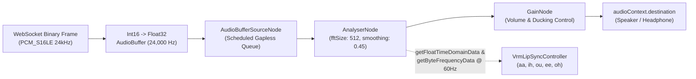

# Contract 2: Audio Pipeline & Lip-Sync Signal Specification (`audio-pipeline-spec.md`)

- **Version:** `1.0.0`
- **Status:** `Locked`
- **Related Documents:** [PRD.md](../../PRD.md), [websocket-protocol.md](./websocket-protocol.md), [vrm-avatar-states.md](./vrm-avatar-states.md)

---

## 1. End-to-End Audio Format Summary

| Parameter | Upstream (Kandidat -> Backend -> Gemini) | Downstream (Gemini -> Backend -> Kandidat) |
| :--- | :--- | :--- |
| **Codec / Encoding** | Uncompressed Raw PCM (`PCM_S16LE`) | Uncompressed Raw PCM (`PCM_S16LE`) |
| **Sample Rate** | **16,000 Hz** | **24,000 Hz** |
| **Bit Depth & Endianness** | 16-bit Signed Integer, Little-Endian (`Int16Array`) | 16-bit Signed Integer, Little-Endian (`Int16Array`) |
| **Channels** | `1` (Mono) | `1` (Mono) |
| **Byte Rate** | `32,000 bytes/sec` (256 kbps) | `48,000 bytes/sec` (384 kbps) |
| **Chunk Size Standar** | `40 ms` = `640 samples` = **`1,280 bytes`** | Variabel dari Gemini (`~100ms - 250ms` per frame) |
| **Gemini MIME Type** | `audio/pcm;rate=16000` | `audio/pcm;rate=24000` |

---

## 2. Upstream Capture Specification (`AudioWorkletNode`)

### 2.1 Browser `getUserMedia` Constraints
```typescript
const MEDIA_CONSTRAINTS: MediaStreamConstraints = {
  audio: {
    channelCount: { ideal: 1 },
    sampleRate: { ideal: 16000 },
    echoCancellation: { ideal: true },
    noiseSuppression: { ideal: true },
    autoGainControl: { ideal: true },
  },
  video: false,
};
```
> **Catatan Penting:** Jangan pernah mematikan `echoCancellation: true`. Fitur ini sangat krusial agar suara AI yang keluar dari speaker laptop kandidat tidak masuk kembali ke mikrofon dan memicu *false barge-in*.

### 2.2 Downsampling & Quantization di `pcm-capture-processor.ts`
1. `AudioWorkletProcessor.process(inputs)` menerima blok 128 sampel `Float32Array` pada `sampleRate` native `AudioContext` (misal 48,000 Hz atau 44,100 Hz).
2. Jika `AudioContext.sampleRate !== 16000`, worklet menerapkan filter *low-pass boxcar/FIR* sederhana sebelum melakukan *downsampling* ke **16,000 Hz**.
3. Setiap sampel `s` (`Float32` dalam rentang `[-1.0, 1.0]`) dikonversi menjadi `Int16`:
   ```typescript
   const clamped = Math.max(-1.0, Math.min(1.0, s));
   const int16Sample = clamped < 0 ? clamped * 0x8000 : clamped * 0x7FFF;
   ```
4. Sampel disimpan ke dalam *ring buffer* internal hingga mencapai **640 sampel (`1,280 bytes`)**, lalu dikirim ke main thread via `this.port.postMessage(buffer, [buffer])`.

### 2.3 Local VAD untuk Audio Ducking (Fast Barge-In Assist)
- Di dalam `AudioWorklet`, hitung RMS per frame 40ms:
  $$\text{RMS}_{\text{mic}} = \sqrt{\frac{1}{640} \sum_{i=0}^{639} s_i^2}$$
- Jika `AvatarState === "SPEAKING"` dan $\text{RMS}_{\text{mic}} > 0.045$ selama **5 frame berturut-turut (200ms)**:
  - Kirim event lokal `local_vad_speech_start` ke `PcmStreamPlayer` untuk menurunkan `outputGainNode.gain` ke `0.20` (*audio ducking*) sambil menunggu konfirmasi `control.barge_in` dari server.

---

## 3. Downstream Playback & Analyser Graph Specification

### 3.1 Web Audio Node Graph Topology


### 3.2 Gapless Scheduling & Barge-In Flush Rules
1. **Konversi Buffer:**
   ```typescript
   const int16 = new Int16Array(arrayBuffer);
   const float32 = new Float32Array(int16.length);
   for (let i = 0; i < int16.length; i++) {
     float32[i] = int16[i] / 32768.0;
   }
   const audioBuffer = audioCtx.createBuffer(1, float32.length, 24000);
   audioBuffer.copyToChannel(float32, 0);
   ```
2. **Initial Jitter Margin:**
   - Pada chunk pertama dari sebuah turn baru (`activeNodes.size === 0`), jadwalkan pemutaran pada `nextPlayTime = audioCtx.currentTime + 0.060` (60ms jitter buffer).
   - Pada chunk selanjutnya: `startTime = Math.max(audioCtx.currentTime + 0.005, nextPlayTime)`, lalu `nextPlayTime = startTime + audioBuffer.duration`.
3. **Instant Flush (`flushPlaybackQueue()`):**
   - Dipanggil saat menerima JSON `control.barge_in`:
     ```typescript
     for (const node of activeSourceNodes) {
       try {
         node.onended = null;
         node.stop(0);
         node.disconnect();
       } catch {}
     }
     activeSourceNodes.clear();
     nextPlayTime = 0;
     ```
   - Waktu eksekusi wajib **< 50ms** dan menghentikan sinyal ke `AnalyserNode` seketika sehingga mulut VRM otomatis menutup.

---

## 4. `AnalyserNode` to VRM Viseme Mapping Specification

- **`AnalyserNode` Parameters:**
  - `fftSize = 512` (`frequencyBinCount = 256`)
  - `smoothingTimeConstant = 0.45`
  - `minDecibels = -85`, `maxDecibels = -10`
- **Frequency Band Indexing (pada `AudioContext` 48,000 Hz, resolusi per bin $\Delta f = 48000 / 512 = 93.75\text{ Hz}$):**
  - **Low Band ($E_{\text{low}}$: ~187 Hz – 750 Hz):** Bin indeks `2` s/d `8`.
  - **Mid Band ($E_{\text{mid}}$: ~750 Hz – 1,875 Hz):** Bin indeks `8` s/d `20`.
  - **High Band ($E_{\text{high}}$: ~1,875 Hz – 3,750 Hz):** Bin indeks `20` s/d `40`.
  *(Catatan: Indeks bin dihitung secara dinamis menggunakan `Math.round(freqHz / (audioCtx.sampleRate / analyser.fftSize))` agar akurat di semua sample rate perangkat).*
