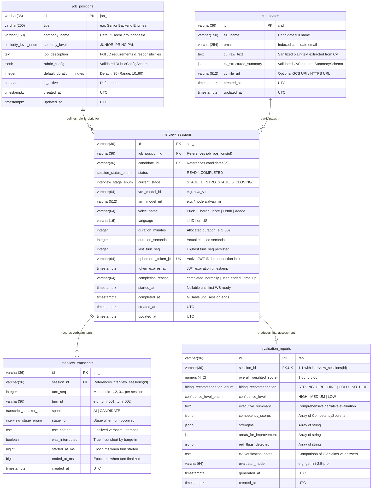

# Contract 4: PostgreSQL Database Schema, ERD & JSONB Specifications (`database-schema.md`)

- **Version:** `1.0.0`
- **Status:** `Locked`
- **Database Engine:** PostgreSQL 16+ (Cloud SQL / Containerized Postgres)
- **ORM & Driver Target:** `SQLAlchemy 2.0 (DeclarativeBase + Mapped)` + `asyncpg` + `Alembic`
- **Related Documents:** [PRD.md](../../PRD.md), [ADR-002](../decisions/ADR-002-backend-tech-stack-and-session-protocol.md), [rest-api-contract.md](./rest-api-contract.md), [websocket-protocol.md](./websocket-protocol.md)

---

## 1. Design Principles & ID Conventions

1. **String-Prefixed Sortable IDs (ULID / UUIDv7 Compatible):**
   - Seluruh Primary Key menggunakan tipe `VARCHAR(36)` dengan prefix entitas yang eksplisit agar mudah dilacak pada log WebSocket, URL, dan laporan:
     - `job_positions.id` -> `job_<26_char_ulid>` (contoh: `"job_01jc9x7a1b2c3d4e5f6g7h8j9k"`)
     - `candidates.id` -> `cnd_<26_char_ulid>` (contoh: `"cnd_01jc9x7p9q8r7s6t5u4v3w2x1y"`)
     - `interview_sessions.id` -> `ses_<26_char_ulid>` (contoh: `"ses_01jc9x8k2m3n4p5q6r7s8t9u0v"`)
     - `interview_transcripts.id` -> `trn_<26_char_ulid>` (contoh: `"trn_01jc9x9z1a2b3c4d5e6f7g8h9j"`)
     - `evaluation_reports.id` -> `rep_<26_char_ulid>` (contoh: `"rep_01jc9xa5b6c7d8e9f0g1h2j3k4"`)
2. **Non-Blocking Async Writes:**
   - Selama wawancara berlangsung di WebSocket Relay, penulisan baris ke `interview_transcripts` dan update `current_stage` pada `interview_sessions` dieksekusi di *background task* menggunakan `asyncpg` agar tidak pernah menambah latensi jalur audio PCM.
3. **Hybrid Relational + Validated `JSONB`:**
   - Atribut yang sering di-filter atau di-join (`session_id`, `status`, `current_stage`, `overall_weighted_score`, `hiring_recommendation`) disimpan sebagai kolom relasional bertipe ketat dan berindeks.
   - Struktur bersarang yang kaya (`rubric_config`, `cv_structured_summary`, `competency_scores`, `strengths`, `areas_for_improvement`, `red_flags_detected`) disimpan sebagai `JSONB` dan divalidasi dengan **Pydantic v2** sebelum `INSERT`/`UPDATE`.
4. **Timezone Discipline:**
   - Seluruh kolom waktu (`created_at`, `updated_at`, `started_at`, `completed_at`, `expires_at`) wajib menggunakan `TIMESTAMPTZ` (`TIMESTAMP WITH TIME ZONE`) dalam UTC.

---

## 2. Entity-Relationship Diagram (`erDiagram`)



---

## 3. PostgreSQL `ENUM` Types Specification

Seluruh tipe `ENUM` di bawah ini didefinisikan secara eksplisit dan berkorespondensi 1:1 dengan konstanta di `websocket-protocol.md` serta `rest-api-contract.md`:

| PostgreSQL `ENUM` Name | Allowed Values | Digunakan Pada Kolom |
| :--- | :--- | :--- |
| **`seniority_level_enum`** | `'JUNIOR'`, `'MID'`, `'SENIOR'`, `'STAFF'`, `'PRINCIPAL'` | `job_positions.seniority_level` |
| **`session_status_enum`** | `'READY'`, `'IN_PROGRESS'`, `'RECONNECTING'`, `'EVALUATING'`, `'COMPLETED'`, `'FAILED'`, `'EXPIRED'` | `interview_sessions.status` |
| **`interview_stage_enum`** | `'STAGE_1_INTRO'`, `'STAGE_2_CV_PROBE'`, `'STAGE_3_TECHNICAL'`, `'STAGE_4_QNA'`, `'STAGE_5_CLOSING'` | `interview_sessions.current_stage`, `interview_transcripts.stage_id` |
| **`transcript_speaker_enum`** | `'AI'`, `'CANDIDATE'` | `interview_transcripts.speaker` |
| **`hiring_recommendation_enum`** | `'STRONG_HIRE'`, `'HIRE'`, `'HOLD'`, `'NO_HIRE'` | `evaluation_reports.hiring_recommendation` |
| **`confidence_level_enum`** | `'HIGH'`, `'MEDIUM'`, `'LOW'` | `evaluation_reports.confidence_level` |

---

## 4. Detailed Table Specifications & Constraints

### 4.1 Tabel 1: `job_positions`
Menyimpan deskripsi lowongan pekerjaan, tingkat senioritas, dan matriks rubrik kompetensi (`rubric_config`).

| Nama Kolom | Tipe Data PostgreSQL | Nullable | Default | Constraints & Keterangan |
| :--- | :--- | :---: | :--- | :--- |
| `id` | `VARCHAR(36)` | `NOT NULL` | — | **PK** (`job_<ulid>`) |
| `title` | `VARCHAR(200)` | `NOT NULL` | — | Judul posisi (contoh: `"Senior Backend Engineer"`). |
| `company_name` | `VARCHAR(150)` | `NOT NULL` | `'Enterprise AI Corp'` | Nama perusahaan yang disebutkan oleh pewawancara AI. |
| `seniority_level` | `seniority_level_enum` | `NOT NULL` | `'SENIOR'` | Level senioritas untuk kalibrasi kedalaman pertanyaan. |
| `job_description` | `TEXT` | `NOT NULL` | — | Deskripsi lengkap tanggung jawab & kualifikasi teknis. |
| `rubric_config` | `JSONB` | `NOT NULL` | — | Konfigurasi rubrik kompetensi tervalidasi (lihat **Section 5.1**). |
| `default_duration_minutes` | `INTEGER` | `NOT NULL` | `30` | `CHECK (default_duration_minutes BETWEEN 10 AND 90)` |
| `is_active` | `BOOLEAN` | `NOT NULL` | `TRUE` | Status aktif lowongan. |
| `created_at` | `TIMESTAMPTZ` | `NOT NULL` | `NOW()` | Timestamp pembuatan. |
| `updated_at` | `TIMESTAMPTZ` | `NOT NULL` | `NOW()` | Timestamp pembaruan terakhir. |

**Indexes (`job_positions`):**
- `pk_job_positions` pada `(id)`
- `idx_job_positions_active_created` pada `(is_active, created_at DESC)`

---

### 4.2 Tabel 2: `candidates`
Menyimpan profil kandidat, teks CV yang telah disanitasi dari *prompt injection*, serta ringkasan CV terstruktur (`cv_structured_summary`).

| Nama Kolom | Tipe Data PostgreSQL | Nullable | Default | Constraints & Keterangan |
| :--- | :--- | :---: | :--- | :--- |
| `id` | `VARCHAR(36)` | `NOT NULL` | — | **PK** (`cnd_<ulid>`) |
| `full_name` | `VARCHAR(150)` | `NOT NULL` | — | Nama lengkap kandidat (diakses sebagai `candidate_name` di DTO REST). |
| `email` | `VARCHAR(254)` | `NOT NULL` | — | Alamat email kandidat. |
| `cv_raw_text` | `TEXT` | `NOT NULL` | — | Teks CV yang sudah melalui `cv_sanitizer` (bebas *override指令*). |
| `cv_structured_summary` | `JSONB` | `NOT NULL` | `'{}'::jsonb` | Ringkasan terstruktur pengalaman, keahlian, & proyek (lihat **Section 5.2**). |
| `cv_file_url` | `VARCHAR(512)` | `NULL` | `NULL` | URL/URI file PDF/DOCX asli di Cloud Storage (opsional). |
| `created_at` | `TIMESTAMPTZ` | `NOT NULL` | `NOW()` | Timestamp pembuatan. |
| `updated_at` | `TIMESTAMPTZ` | `NOT NULL` | `NOW()` | Timestamp pembaruan terakhir. |

**Indexes (`candidates`):**
- `pk_candidates` pada `(id)`
- `idx_candidates_email` pada `(LOWER(email))`

---

### 4.3 Tabel 3: `interview_sessions`
Tabel orkestrasi utama yang melacak siklus hidup sesi wawancara, konfigurasi avatar/suara, tahapan saat ini, dan penguncian token sesi (*ephemeral token JTI*).

| Nama Kolom | Tipe Data PostgreSQL | Nullable | Default | Constraints & Keterangan |
| :--- | :--- | :---: | :--- | :--- |
| `id` | `VARCHAR(36)` | `NOT NULL` | — | **PK** (`ses_<ulid>`). Dirujuk sebagai `session_id` di seluruh API & WS. |
| `job_position_id` | `VARCHAR(36)` | `NOT NULL` | — | **FK** -> `job_positions(id) ON DELETE RESTRICT` |
| `candidate_id` | `VARCHAR(36)` | `NOT NULL` | — | **FK** -> `candidates(id) ON DELETE RESTRICT` |
| `status` | `session_status_enum` | `NOT NULL` | `'READY'` | Status siklus hidup sesi wawancara. |
| `current_stage` | `interview_stage_enum` | `NOT NULL` | `'STAGE_1_INTRO'` | Tahapan wawancara aktif saat ini. |
| `interviewer_persona_name`| `VARCHAR(100)` | `NOT NULL` | `'Alya'` | Nama persona pewawancara AI. |
| `vrm_model_id` | `VARCHAR(64)` | `NOT NULL` | `'alya_v1'` | ID preset karakter 3D VRM. |
| `vrm_model_url` | `VARCHAR(512)` | `NOT NULL` | `'/models/alya.vrm'` | URL publik/CDN untuk memuat file `.vrm` di browser kandidat. |
| `voice_name` | `VARCHAR(64)` | `NOT NULL` | `'Aoede'` | Nama suara Gemini Live (`'Puck'`, `'Charon'`, `'Kore'`, `'Fenrir'`, `'Aoede'`). |
| `language` | `VARCHAR(16)` | `NOT NULL` | `'id-ID'` | Kode bahasa wawancara (`'id-ID'` atau `'en-US'`). |
| `duration_minutes` | `INTEGER` | `NOT NULL` | `30` | Durasi target wawancara dalam menit (`10..90`). |
| `duration_seconds` | `INTEGER` | `NOT NULL` | `0` | Total detik aktual yang telah berjalan (`>= 0`). |
| `last_turn_seq` | `INTEGER` | `NOT NULL` | `0` | Nomor urut `turn_seq` terakhir untuk *Session Resumption*. |
| `ephemeral_token_jti` | `VARCHAR(64)` | `NOT NULL` | — | **UNIQUE** ID klaim `jti` dari JWT kandidat untuk mencegah pembajakan sesi. |
| `token_expires_at` | `TIMESTAMPTZ` | `NOT NULL` | — | Waktu kedaluwarsa tautan undangan kandidat. |
| `completion_reason` | `VARCHAR(64)` | `NULL` | `NULL` | `'completed_normally'` \| `'user_ended'` \| `'time_up'` \| `'system_error'`. |
| `started_at` | `TIMESTAMPTZ` | `NULL` | `NULL` | Diisi saat `client.ready` pertama kali diterima. |
| `completed_at` | `TIMESTAMPTZ` | `NULL` | `NULL` | Diisi saat sesi berakhir / masuk ke `EVALUATING`. |
| `created_at` | `TIMESTAMPTZ` | `NOT NULL` | `NOW()` | Timestamp pembuatan sesi. |
| `updated_at` | `TIMESTAMPTZ` | `NOT NULL` | `NOW()` | Timestamp pembaruan terakhir. |

**Indexes (`interview_sessions`):**
- `pk_interview_sessions` pada `(id)`
- `uq_interview_sessions_token_jti` (`UNIQUE`) pada `(ephemeral_token_jti)`
- `idx_interview_sessions_status_created` pada `(status, created_at DESC)` — untuk dashboard Recruiter
- `idx_interview_sessions_candidate_id` pada `(candidate_id)`
- `idx_interview_sessions_job_position_id` pada `(job_position_id)`

---

### 4.4 Tabel 4: `interview_transcripts`
Menyimpan seluruh giliran bicara (*turns*) secara berurutan antara AI dan Kandidat. Digunakan untuk *Live Captions*, *Session Resumption* (mengambil 10 giliran terakhir saat reconnect), dan input *Post-Interview Evaluation Worker*.

| Nama Kolom | Tipe Data PostgreSQL | Nullable | Default | Constraints & Keterangan |
| :--- | :--- | :---: | :--- | :--- |
| `id` | `VARCHAR(36)` | `NOT NULL` | — | **PK** (`trn_<ulid>`) |
| `session_id` | `VARCHAR(36)` | `NOT NULL` | — | **FK** -> `interview_sessions(id) ON DELETE CASCADE` |
| `turn_seq` | `INTEGER` | `NOT NULL` | — | Nomor urut monotonik per sesi (`1, 2, 3, ...`). |
| `turn_id` | `VARCHAR(36)` | `NOT NULL` | — | Identifier turn pada protokol WS (contoh: `"turn_001"`, `"turn_002"`). |
| `speaker` | `transcript_speaker_enum` | `NOT NULL` | — | `'AI'` atau `'CANDIDATE'`. |
| `stage_id` | `interview_stage_enum` | `NOT NULL` | — | Tahapan wawancara saat giliran bicara ini terjadi. |
| `text_content` | `TEXT` | `NOT NULL` | — | Teks transkrip final dari giliran bicara tersebut. |
| `was_interrupted` | `BOOLEAN` | `NOT NULL` | `FALSE` | Bernilai `TRUE` jika giliran AI ini dipotong oleh *barge-in* kandidat. |
| `started_at_ms` | `BIGINT` | `NOT NULL` | — | Unix epoch milliseconds saat ucapan dimulai. |
| `ended_at_ms` | `BIGINT` | `NOT NULL` | — | Unix epoch milliseconds saat ucapan berakhir (`ended_at_ms >= started_at_ms`). |
| `created_at` | `TIMESTAMPTZ` | `NOT NULL` | `NOW()` | Timestamp penyimpanan baris ke DB. |

**Constraints & Indexes (`interview_transcripts`):**
- `pk_interview_transcripts` pada `(id)`
- `uq_interview_transcripts_session_turn_seq` (`UNIQUE`) pada `(session_id, turn_seq)`
- `idx_interview_transcripts_session_stage` pada `(session_id, stage_id, turn_seq ASC)`

---

### 4.5 Tabel 5: `evaluation_reports`
Menyimpan hasil akhir penilaian terstruktur yang dihasilkan oleh `PostInterviewEvaluationWorker` (Gemini 2.5 Pro *Structured Outputs*). Memiliki relasi **1-to-1** dengan `interview_sessions`.

| Nama Kolom | Tipe Data PostgreSQL | Nullable | Default | Constraints & Keterangan |
| :--- | :--- | :---: | :--- | :--- |
| `id` | `VARCHAR(36)` | `NOT NULL` | — | **PK** (`rep_<ulid>`) |
| `session_id` | `VARCHAR(36)` | `NOT NULL` | — | **FK & UNIQUE** -> `interview_sessions(id) ON DELETE CASCADE` |
| `overall_weighted_score` | `NUMERIC(4, 2)` | `NOT NULL` | — | `CHECK (overall_weighted_score BETWEEN 1.00 AND 5.00)` |
| `hiring_recommendation` | `hiring_recommendation_enum`| `NOT NULL` | — | `'STRONG_HIRE'`, `'HIRE'`, `'HOLD'`, atau `'NO_HIRE'`. |
| `confidence_level` | `confidence_level_enum` | `NOT NULL` | `'HIGH'` | `'HIGH'`, `'MEDIUM'`, atau `'LOW'`. |
| `executive_summary` | `TEXT` | `NOT NULL` | — | Ringkasan eksekutif naratif mengenai performa kandidat. |
| `competency_scores` | `JSONB` | `NOT NULL` | — | Array objek penilaian per kompetensi + kutipan bukti (lihat **Section 5.3**). |
| `strengths` | `JSONB` | `NOT NULL` | `'[]'::jsonb` | Array string (`string[]`) keunggulan utama kandidat. |
| `areas_for_improvement` | `JSONB` | `NOT NULL` | `'[]'::jsonb` | Array string (`string[]`) area pengembangan kandidat. |
| `red_flags_detected` | `JSONB` | `NOT NULL` | `'[]'::jsonb` | Array string (`string[]`) indikasi inkonsistensi/red flag (kosong `[]` jika bersih). |
| `cv_verification_notes` | `TEXT` | `NOT NULL` | — | Evaluasi kesesuaian klaim di CV dengan jawaban lisan kandidat. |
| `evaluator_model` | `VARCHAR(64)` | `NOT NULL` | `'gemini-2.5-pro'` | Nama model LLM yang menghasilkan evaluasi. |
| `generated_at` | `TIMESTAMPTZ` | `NOT NULL` | `NOW()` | Waktu evaluasi selesai dibuat. |
| `created_at` | `TIMESTAMPTZ` | `NOT NULL` | `NOW()` | Timestamp pembuatan baris. |

**Indexes (`evaluation_reports`):**
- `pk_evaluation_reports` pada `(id)`
- `uq_evaluation_reports_session_id` (`UNIQUE`) pada `(session_id)`
- `idx_evaluation_reports_recommendation_score` pada `(hiring_recommendation, overall_weighted_score DESC)`
- `idx_evaluation_reports_competency_gin` (`GIN`) pada `(competency_scores)`

---

## 5. Exact JSON Schemas for `JSONB` Columns

Seluruh kolom `JSONB` wajib mematuhi skema JSON berikut (Draft 2020-12) dan divalidasi oleh model Pydantic v2 di backend sebelum disimpan ke PostgreSQL.

### 5.1 `job_positions.rubric_config` (`RubricConfigSchema`)
Menentukan daftar kompetensi yang harus digali selama wawancara beserta bobot persentasenya (jumlah total `weight_percentage` seluruh item wajib sama dengan `100`).

```json
{
  "$schema": "https://json-schema.org/draft/2020-12/schema",
  "title": "RubricConfigSchema",
  "type": "object",
  "required": ["version", "passing_score_threshold", "criteria"],
  "additionalProperties": false,
  "properties": {
    "version": {
      "type": "string",
      "const": "1.0"
    },
    "passing_score_threshold": {
      "type": "number",
      "minimum": 1.0,
      "maximum": 5.0,
      "default": 3.5,
      "description": "Batas nilai minimum rekomendasi HIRE (skala 1.0 - 5.0)"
    },
    "criteria": {
      "type": "array",
      "minItems": 1,
      "maxItems": 8,
      "items": {
        "type": "object",
        "required": [
          "competency_id",
          "competency_name",
          "weight_percentage",
          "probing_guidance",
          "positive_signals",
          "red_flag_signals"
        ],
        "additionalProperties": false,
        "properties": {
          "competency_id": {
            "type": "string",
            "pattern": "^[a-z0-9_]{3,50}$",
            "examples": ["comp_sys_design", "comp_async_python", "comp_problem_solving"]
          },
          "competency_name": {
            "type": "string",
            "minLength": 3,
            "maxLength": 120,
            "examples": ["Distributed Systems & Scalability"]
          },
          "weight_percentage": {
            "type": "integer",
            "minimum": 5,
            "maximum": 100,
            "description": "Total jumlah weight_percentage seluruh criteria wajib = 100"
          },
          "probing_guidance": {
            "type": "string",
            "description": "Instruksi topik yang harus ditanyakan oleh AI Interviewer pada STAGE_3_TECHNICAL"
          },
          "positive_signals": {
            "type": "array",
            "items": { "type": "string" },
            "minItems": 1,
            "description": "Indikator jawaban kandidat bernilai tinggi (Skor 4-5)"
          },
          "red_flag_signals": {
            "type": "array",
            "items": { "type": "string" },
            "description": "Indikator jawaban lemah atau miskonsepsi fatal (Skor 1-2)"
          }
        }
      }
    }
  }
}
```

---

### 5.2 `candidates.cv_structured_summary` (`CvStructuredSummarySchema`)
Hasil ekstraksi struktur CV kandidat yang disuntikkan ke dalam `DynamicPromptInjector` untuk memandu pertanyaan pada `STAGE_2_CV_PROBE`.

```json
{
  "$schema": "https://json-schema.org/draft/2020-12/schema",
  "title": "CvStructuredSummarySchema",
  "type": "object",
  "required": [
    "headline",
    "years_of_experience",
    "core_skills",
    "work_experiences",
    "notable_projects",
    "probing_highlights"
  ],
  "additionalProperties": false,
  "properties": {
    "headline": {
      "type": "string",
      "examples": ["Senior Backend Engineer dengan 6 tahun pengalaman di sistem pembayaran & microservices"]
    },
    "years_of_experience": {
      "type": "number",
      "minimum": 0,
      "maximum": 50
    },
    "core_skills": {
      "type": "array",
      "items": { "type": "string" },
      "examples": [["Python", "FastAPI", "PostgreSQL", "Kubernetes", "WebSockets"]]
    },
    "work_experiences": {
      "type": "array",
      "items": {
        "type": "object",
        "required": ["company", "role", "duration_label", "key_achievements"],
        "additionalProperties": false,
        "properties": {
          "company": { "type": "string" },
          "role": { "type": "string" },
          "duration_label": { "type": "string", "examples": ["2022 - Present (3 thn)"] },
          "key_achievements": {
            "type": "array",
            "items": { "type": "string" }
          }
        }
      }
    },
    "notable_projects": {
      "type": "array",
      "items": {
        "type": "object",
        "required": ["name", "tech_stack", "summary"],
        "additionalProperties": false,
        "properties": {
          "name": { "type": "string" },
          "tech_stack": { "type": "array", "items": { "type": "string" } },
          "summary": { "type": "string" }
        }
      }
    },
    "probing_highlights": {
      "type": "array",
      "items": { "type": "string" },
      "description": "Daftar klaim spesifik di CV yang perlu dikonfirmasi kebenarannya menggunakan metode STAR"
    }
  }
}
```

---

### 5.3 `evaluation_reports.competency_scores` (`CompetencyScoreListSchema`)
Rincian penilaian per dimensi rubrik beserta kutipan bukti verbatim (`supporting_quotes`) dari tabel `interview_transcripts`.

```json
{
  "$schema": "https://json-schema.org/draft/2020-12/schema",
  "title": "CompetencyScoreListSchema",
  "type": "array",
  "minItems": 1,
  "items": {
    "type": "object",
    "required": [
      "competency_id",
      "competency_name",
      "weight_percentage",
      "score",
      "rationale",
      "supporting_quotes"
    ],
    "additionalProperties": false,
    "properties": {
      "competency_id": {
        "type": "string",
        "description": "Wajib cocok dengan competency_id pada job_positions.rubric_config"
      },
      "competency_name": {
        "type": "string"
      },
      "weight_percentage": {
        "type": "integer",
        "minimum": 5,
        "maximum": 100
      },
      "score": {
        "type": "number",
        "minimum": 1.0,
        "maximum": 5.0,
        "description": "Nilai kompetensi pada skala 1.0 s/d 5.0 (interval 0.5 diizinkan)"
      },
      "rationale": {
        "type": "string",
        "minLength": 20,
        "description": "Penjelasan objektif mengapa kandidat mendapatkan skor tersebut"
      },
      "supporting_quotes": {
        "type": "array",
        "items": {
          "type": "object",
          "required": ["turn_id", "timestamp_sec", "speaker", "quote"],
          "additionalProperties": false,
          "properties": {
            "turn_id": {
              "type": "string",
              "examples": ["turn_008"]
            },
            "timestamp_sec": {
              "type": "integer",
              "minimum": 0,
              "description": "Detik relatif sejak awal sesi wawancara"
            },
            "speaker": {
              "type": "string",
              "enum": ["CANDIDATE", "AI"]
            },
            "quote": {
              "type": "string",
              "description": "Kutipan verbatim dari interview_transcripts.text_content"
            }
          }
        }
      }
    }
  }
}
```

---

## 6. Reference PostgreSQL DDL (`schema.sql` / Alembic Baseline)

```sql
-- 1. ENUM Types
CREATE TYPE seniority_level_enum AS ENUM ('JUNIOR', 'MID', 'SENIOR', 'STAFF', 'PRINCIPAL');
CREATE TYPE session_status_enum AS ENUM ('READY', 'IN_PROGRESS', 'RECONNECTING', 'EVALUATING', 'COMPLETED', 'FAILED', 'EXPIRED');
CREATE TYPE interview_stage_enum AS ENUM ('STAGE_1_INTRO', 'STAGE_2_CV_PROBE', 'STAGE_3_TECHNICAL', 'STAGE_4_QNA', 'STAGE_5_CLOSING');
CREATE TYPE transcript_speaker_enum AS ENUM ('AI', 'CANDIDATE');
CREATE TYPE hiring_recommendation_enum AS ENUM ('STRONG_HIRE', 'HIRE', 'HOLD', 'NO_HIRE');
CREATE TYPE confidence_level_enum AS ENUM ('HIGH', 'MEDIUM', 'LOW');

-- 2. Table: job_positions
CREATE TABLE job_positions (
    id VARCHAR(36) PRIMARY KEY,
    title VARCHAR(200) NOT NULL,
    company_name VARCHAR(150) NOT NULL DEFAULT 'Enterprise AI Corp',
    seniority_level seniority_level_enum NOT NULL DEFAULT 'SENIOR',
    job_description TEXT NOT NULL,
    rubric_config JSONB NOT NULL,
    default_duration_minutes INTEGER NOT NULL DEFAULT 30 CHECK (default_duration_minutes BETWEEN 10 AND 90),
    is_active BOOLEAN NOT NULL DEFAULT TRUE,
    created_at TIMESTAMPTZ NOT NULL DEFAULT NOW(),
    updated_at TIMESTAMPTZ NOT NULL DEFAULT NOW()
);
CREATE INDEX idx_job_positions_active_created ON job_positions (is_active, created_at DESC);

-- 3. Table: candidates
CREATE TABLE candidates (
    id VARCHAR(36) PRIMARY KEY,
    full_name VARCHAR(150) NOT NULL,
    email VARCHAR(254) NOT NULL,
    cv_raw_text TEXT NOT NULL,
    cv_structured_summary JSONB NOT NULL DEFAULT '{}'::jsonb,
    cv_file_url VARCHAR(512),
    created_at TIMESTAMPTZ NOT NULL DEFAULT NOW(),
    updated_at TIMESTAMPTZ NOT NULL DEFAULT NOW()
);
CREATE INDEX idx_candidates_email ON candidates (LOWER(email));

-- 4. Table: interview_sessions
CREATE TABLE interview_sessions (
    id VARCHAR(36) PRIMARY KEY,
    job_position_id VARCHAR(36) NOT NULL REFERENCES job_positions(id) ON DELETE RESTRICT,
    candidate_id VARCHAR(36) NOT NULL REFERENCES candidates(id) ON DELETE RESTRICT,
    status session_status_enum NOT NULL DEFAULT 'READY',
    current_stage interview_stage_enum NOT NULL DEFAULT 'STAGE_1_INTRO',
    interviewer_persona_name VARCHAR(100) NOT NULL DEFAULT 'Alya',
    vrm_model_id VARCHAR(64) NOT NULL DEFAULT 'alya_v1',
    vrm_model_url VARCHAR(512) NOT NULL DEFAULT '/models/alya.vrm',
    voice_name VARCHAR(64) NOT NULL DEFAULT 'Aoede',
    language VARCHAR(16) NOT NULL DEFAULT 'id-ID',
    duration_minutes INTEGER NOT NULL DEFAULT 30 CHECK (duration_minutes BETWEEN 10 AND 90),
    duration_seconds INTEGER NOT NULL DEFAULT 0 CHECK (duration_seconds >= 0),
    last_turn_seq INTEGER NOT NULL DEFAULT 0 CHECK (last_turn_seq >= 0),
    ephemeral_token_jti VARCHAR(64) NOT NULL UNIQUE,
    token_expires_at TIMESTAMPTZ NOT NULL,
    completion_reason VARCHAR(64),
    started_at TIMESTAMPTZ,
    completed_at TIMESTAMPTZ,
    created_at TIMESTAMPTZ NOT NULL DEFAULT NOW(),
    updated_at TIMESTAMPTZ NOT NULL DEFAULT NOW()
);
CREATE INDEX idx_interview_sessions_status_created ON interview_sessions (status, created_at DESC);
CREATE INDEX idx_interview_sessions_candidate_id ON interview_sessions (candidate_id);
CREATE INDEX idx_interview_sessions_job_position_id ON interview_sessions (job_position_id);

-- 5. Table: interview_transcripts
CREATE TABLE interview_transcripts (
    id VARCHAR(36) PRIMARY KEY,
    session_id VARCHAR(36) NOT NULL REFERENCES interview_sessions(id) ON DELETE CASCADE,
    turn_seq INTEGER NOT NULL CHECK (turn_seq >= 1),
    turn_id VARCHAR(36) NOT NULL,
    speaker transcript_speaker_enum NOT NULL,
    stage_id interview_stage_enum NOT NULL,
    text_content TEXT NOT NULL,
    was_interrupted BOOLEAN NOT NULL DEFAULT FALSE,
    started_at_ms BIGINT NOT NULL,
    ended_at_ms BIGINT NOT NULL CHECK (ended_at_ms >= started_at_ms),
    created_at TIMESTAMPTZ NOT NULL DEFAULT NOW(),
    CONSTRAINT uq_interview_transcripts_session_turn_seq UNIQUE (session_id, turn_seq)
);
CREATE INDEX idx_interview_transcripts_session_stage ON interview_transcripts (session_id, stage_id, turn_seq ASC);

-- 6. Table: evaluation_reports
CREATE TABLE evaluation_reports (
    id VARCHAR(36) PRIMARY KEY,
    session_id VARCHAR(36) NOT NULL UNIQUE REFERENCES interview_sessions(id) ON DELETE CASCADE,
    overall_weighted_score NUMERIC(4, 2) NOT NULL CHECK (overall_weighted_score BETWEEN 1.00 AND 5.00),
    hiring_recommendation hiring_recommendation_enum NOT NULL,
    confidence_level confidence_level_enum NOT NULL DEFAULT 'HIGH',
    executive_summary TEXT NOT NULL,
    competency_scores JSONB NOT NULL,
    strengths JSONB NOT NULL DEFAULT '[]'::jsonb,
    areas_for_improvement JSONB NOT NULL DEFAULT '[]'::jsonb,
    red_flags_detected JSONB NOT NULL DEFAULT '[]'::jsonb,
    cv_verification_notes TEXT NOT NULL,
    evaluator_model VARCHAR(64) NOT NULL DEFAULT 'gemini-2.5-pro',
    generated_at TIMESTAMPTZ NOT NULL DEFAULT NOW(),
    created_at TIMESTAMPTZ NOT NULL DEFAULT NOW()
);
CREATE INDEX idx_evaluation_reports_recommendation_score ON evaluation_reports (hiring_recommendation, overall_weighted_score DESC);
CREATE INDEX idx_evaluation_reports_competency_gin ON evaluation_reports USING GIN (competency_scores);
```
